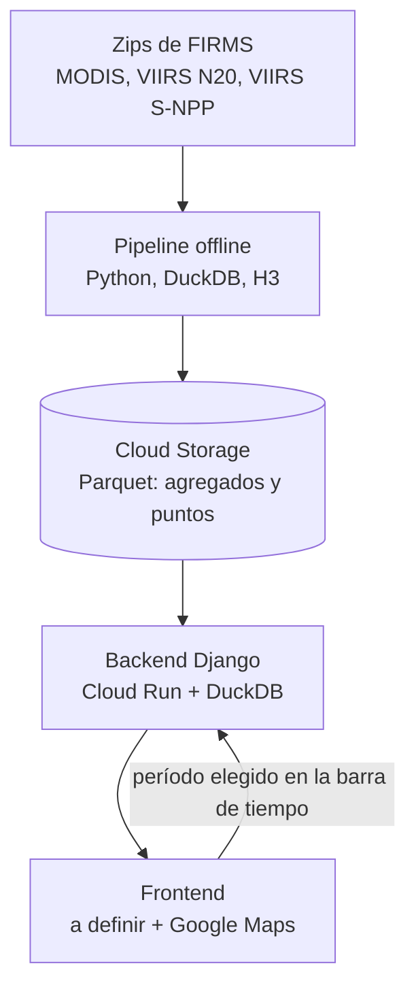

# Arquitectura del proyecto

Calendario de actividad de quemas harmonizado (MODIS + VIIRS) — NASA Space Apps Challenge 2026, challenge *Harmonization of MODIS and VIIRS Hot Spots*.

Estado: **acordado por el equipo**, salvo los puntos marcados como abiertos.
Documentos relacionados: `PLAN.md` (plan general), `PLAN_MODULO_DATOS.md` (sprints del módulo de datos, diccionario de campos FIRMS y advertencias de la documentación) y `PLAN_NORMALIZACION.md` (esquema, filtros, calibración y validación de la serie harmonizada).

---

## 1. Principio de diseño

**Todo lo pesado se calcula una sola vez, offline; la app solo consulta resultados precalculados.**

Los datos crudos son decenas de millones de focos. Limpiar, indexar en H3 y harmonizar lleva minutos u horas, y no puede pasar mientras un usuario espera. El pipeline hace todo ese trabajo de antemano y deja tablas chicas y listas para consultar. Así el backend se limita a filtrar y sumar.

## 2. Decisiones

| Área | Decisión | Estado |
|---|---|---|
| Procesamiento de datos | Python (CPython) con DuckDB / polars | Acordado |
| Grilla espacial | Hexágonos H3 (resolución final en el Sprint 5 del módulo de datos) | Acordado |
| Almacenamiento | Archivos Parquet en Google Cloud Storage | Acordado |
| Base de datos | Sin servidor de base de datos para los datos de fuego; DuckDB embebido consulta los Parquet. SQLite solo para lo interno de Django | Acordado |
| Backend / API | Python + Django, desplegado en Google Cloud Run | Acordado |
| Mapa | Google Maps JavaScript API | Acordado |
| Zona de la demo | Una sola zona fija: norte de la Patagonia (Río Negro y Neuquén). Todo se precalcula para esa zona | Acordado |
| Números que muestra la app | Siempre la serie harmonizada. Nunca conteos por sensor | Acordado |
| Navegación temporal | Barra de tiempo que se recorre (o se reproduce) y va mostrando los focos en el mapa | Acordado |
| Frontend | A definir por el equipo de front | **Abierto** |
| Hosting | Google Cloud (Global Offers de Space Apps) | Acordado |
| Dominio | GoDaddy (Global Offers), apuntado al servicio en Google Cloud | Acordado |
| Datos meteorológicos (Meteomatics) | Fuera del alcance; mejora futura | Postergado |

### Por qué no MongoDB

La carga de trabajo es analítica: sumar series de miles de celdas por mes, calcular medianas históricas y filtrar millones de puntos por área y fecha. Eso es justo lo que resuelve una base columnar como DuckDB. MongoDB es una base de documentos, y para este tipo de agregaciones es más lenta y más difícil de usar. Además, Django está pensado para bases relacionales y el soporte para MongoDB es inmaduro, lo que sumaría horas de integración en pleno hackatón.

### Por qué no PostgreSQL

Sería la alternativa "tradicional" sólida (PostGIS + extensión h3-pg en Cloud SQL), pero suma costo y tiempo de setup y administración sin mejorar el rendimiento para este caso. Queda como opción si el proyecto sigue después del hackatón.

## 3. Vista general



## 4. Componentes

### 4.1 Pipeline de datos (offline)

Lo detallan `PLAN_MODULO_DATOS.md` (sprints) y `PLAN_NORMALIZACION.md` (reglas). Resumen de etapas:

1. **Ingesta:** zips → Parquet con esquema unificado, sin filtros.
2. **Limpieza:** `type = 0` más la máscara de fuentes estáticas (cubre los datos NRT sin `type` y MODIS anterior a 2018), clase de confianza común, fecha local solar (`local_date`), marca de colección y versión.
3. **Indexación H3:** r8 y r7 por foco; las resoluciones gruesas se derivan con `cell_to_parent`.
4. **Agregación:** conteos por celda × día local × plataforma × día/noche, con los rollups mensuales y de 8 días.
5. **Harmonización:** `k` por región × mes × día/noche, ajustado en el solape estable (hasta 2021-12, antes de la deriva de Terra y Aqua); desde `switch_date` la serie usa VIIRS × `k`.
6. **Publicación:** exportación de las tablas finales a Parquet y subida a Cloud Storage.

Corre en la máquina de quien procesa (o en una VM temporal de Google Cloud si el volumen lo pide) y se vuelve a ejecutar solo cuando cambian los datos de entrada o la metodología.

### 4.2 Almacenamiento

Estructura propuesta en el bucket:

```
gs://<bucket>/
├── series/            # serie mensual harmonizada por celda
│   └── res=<r>/part-*.parquet          (cell, region_r3, year, month, platform, is_day,
│                                        n_fires, n_equiv, coverage_frac, config_hash)
├── calibration/       # k por estrato y sus réplicas bootstrap (bandas de incertidumbre)
│   └── part-*.parquet                  (source_platform, region, month, is_day, k, replica)
├── map/               # valores por celda para pintar el mapa, una resolución por nivel de zoom
│   └── res=<r>/part-*.parquet          (cell, year, month, n_equiv, anomaly_pct)
├── points/            # focos limpios para exportar a CSV
│   └── year=<YYYY>/h3_r3=<celda>/part-*.parquet
└── meta/
    └── version.json   # versión del dataset, fecha de proceso, parámetros, config_hash,
                       # switch_date y períodos con cobertura reducida
```

Los puntos se particionan por año y por una celda H3 gruesa (res 3) para que una consulta de un área chica lea solo unos pocos archivos y no todo el dataset.

**La mediana histórica se calcula sobre la serie de la zona, no por celda.** La mediana de un área no es la suma de las medianas de sus celdas: hay que sumar la zona año por año (reponiendo los ceros con `calendar`, ver `PLAN_NORMALIZACION.md` §4.5 y §7) y recién después tomar la mediana por mes. Como la zona es fija, eso se hace una vez en el pipeline y se guarda en `zone/`:

```
gs://<bucket>/zone/
├── outline.geojson     # contorno de la zona
├── calendar.parquet    (year, month, n_equiv, p05, p95, coverage_frac)
├── baseline.parquet    (month, median, p10, p25, p75, p90, n_years)
└── timeline_8d.parquet (year, period_8d, period_start, n_equiv, p05, p95, coverage_frac)
```

En `map/`, en cambio, cada celda se pinta sola, así que su anomalía sí puede venir precalculada por celda.

### 4.3 Backend (Django en Cloud Run)

- Django sirve la API, y las páginas si el equipo de front decide usar templates.
- Las vistas consultan los Parquet con DuckDB. No hay ORM para los datos de fuego.
- `series/`, `calibration/` y `map/` son chicos (solo Argentina), así que el contenedor los copia a disco local al arrancar, o vienen dentro de la imagen. Leerlos con `httpfs` desde Cloud Storage en cada consulta suma demora, sobre todo cuando Cloud Run arranca en frío. `points/` sí se lee con `httpfs`, porque es grande y solo se usa para el CSV.
- Para lo propio de Django (admin, sesiones) alcanza con SQLite. No guardamos datos de usuarios.
- El servicio es stateless, así que Cloud Run puede escalar a cero cuando no hay uso.

### 4.4 Frontend

**Framework a definir por el equipo de front.** La arquitectura solo pide que el frontend pueda:

- Mostrar un mapa de Google Maps centrado en la zona, con su contorno y una capa de hexágonos con el valor harmonizado (por ejemplo deck.gl `H3HexagonLayer` con `GoogleMapsOverlay`), cambiando la resolución según el zoom (tabla abajo).
- Mostrar los focos sobre el mapa al recorrer la **barra de tiempo** (ver abajo).
- Mostrar el calendario año × mes con una rampa de color accesible y la comparación contra la mediana.
- Marcar los períodos con `coverage_frac < 1` y aclarar que los valores son estimaciones harmonizadas.
- Descargar el CSV de los focos del rango elegido. Como los puntos de la zona ya están cargados para la animación, el CSV se puede armar en el navegador.

No hace falta dibujar áreas ni convertir polígonos en celdas: la zona es fija y sus celdas se calculan una sola vez en el pipeline.

#### Barra de tiempo

- Franja con los meses de 2000-11 a hoy, pintada con la misma rampa del calendario, con un cursor que se arrastra o se reproduce (play/pausa y velocidad).
- **Paso mensual** para recorrer los 26 años y **paso diario** dentro de una temporada (por ejemplo, el verano de un incendio).
- En el mapa se ven los focos de una **ventana deslizante** (el mes, o los últimos 8 días en paso diario); los más viejos se desvanecen, así se ve cómo avanza el fuego.
- Los focos se pintan todos iguales, sin distinguir sensor: color y tamaño según FRP. El sensor aparece solo en el detalle al pasar el mouse.
- Al lado del cursor, el valor **harmonizado** de la ventana y su anomalía contra la mediana histórica. Nunca el conteo de puntos: los focos VIIRS son 3–5 veces más que los MODIS, y contar puntos mostraría un salto falso desde 2018.
- Debajo de los puntos, la capa de hexágonos con el valor harmonizado del período. Es la que permite comparar años a simple vista, aunque la densidad de puntos cambie con el sensor.
- Implementación sugerida: deck.gl `ScatterplotLayer` con `DataFilterExtension` (`filterRange` sobre la fecha). Los puntos se cargan una vez por año y el filtro corre en la GPU, así que arrastrar el cursor es fluido.
- Con paso diario, el valor que se muestra es el de la ventana de 8 días, no el del día suelto: la guía MODIS advierte sesgos en series de menos de ~8 días.

Resolución de los hexágonos según el zoom (propuesta). Río Negro y Neuquén suman ~300.000 km², unas 57.000 celdas r7: demasiadas para la vista completa de la zona.

| Zoom de Google Maps | Qué se dibuja |
|---|---|
| ≤ 6 | H3 r5 (~250 km²) |
| 7–8 | H3 r6 (~36 km²) |
| ≥ 9 | H3 r7 (~5 km²) |

Los focos de la barra de tiempo se dibujan encima en todos los niveles. Con zoom ≥ 12, los focos MODIS pueden dibujarse con su huella real (`scan × track`) en vez de un punto.

## 5. Contrato de la API (borrador)

Se cierra con el equipo de front. Los endpoints son orientativos.

| Método | Ruta | Entrada | Salida |
|---|---|---|---|
| `GET` | `/api/calendar` | `from, to` | Matriz año × mes de la zona con el valor harmonizado y `coverage_frac`; más la mediana y los percentiles históricos por mes |
| `GET` | `/api/timeline` | `from, to, step` (`month` o `8d`) | Valor harmonizado, banda de incertidumbre (p05–p95) y anomalía por paso, para la barra de tiempo |
| `GET` | `/api/map` | `zoom, from, to` | Valor harmonizado por celda en ese período; el backend elige la resolución según el zoom |
| `GET` | `/api/points` | `year` | Focos limpios de la zona en ese año, en formato columnar compacto (Parquet o Arrow): lat, lon, fecha y hora, FRP, día/noche, sensor |
| `GET` | `/api/meta` | — | Contorno de la zona (GeoJSON), versión del dataset, `config_hash`, cobertura temporal y períodos con cobertura reducida |

Como la zona es fija, ningún endpoint recibe geometrías ni listas de celdas, y todas las respuestas se pueden precalcular. Si aprieta el tiempo, `calendar`, `timeline`, `map` y `points` pueden ser archivos estáticos en Cloud Storage en vez de vistas de Django.

**Todos los valores numéricos son de la serie harmonizada.** La API no expone conteos por sensor. Las series por sensor existen en el pipeline para calibrar y validar (y para el gráfico antes/después del pitch), pero no llegan a la app.

## 6. Flujo de una consulta

1. Al abrir la app, el front pide `/api/meta`, `/api/calendar` y `/api/timeline`, y muestra el mapa con el contorno de la zona y la barra de tiempo.
2. El usuario arrastra el cursor o aprieta play. El front pide `/api/points` del año en curso (y el siguiente, por adelantado) y `/api/map` del período.
3. Al mover el cursor, el front solo cambia el filtro de fecha de la capa de puntos y muestra el valor harmonizado de ese paso, que ya tiene de `/api/timeline`.
4. Si el usuario pide el CSV, el front lo arma con los puntos cargados del rango elegido.

En el pipeline, la serie de la zona se arma sumando sus celdas año por año, reponiendo los ceros con `calendar`; la mediana y los percentiles salen de esa serie.

## 7. Despliegue

| Pieza | Servicio |
|---|---|
| Datos procesados | Google Cloud Storage |
| Backend Django | Google Cloud Run (contenedor Docker) |
| Frontend | Según lo que defina el front: lo sirve Django, o va a Firebase Hosting si es una SPA separada |
| Dominio | GoDaddy → apuntado a Cloud Run o Firebase |
| Mapa | Google Maps Platform (clave del proyecto de Google Cloud) |

Antes de desplegar hay que revisar en la página de Global Offers qué créditos da Google Cloud, si piden tarjeta y qué cuotas tiene la Maps API.

## 8. Seguridad y secretos

- **Ningún secreto en el repositorio.** Claves de API, credenciales de Google Cloud y `SECRET_KEY` de Django van en variables de entorno o en Secret Manager, nunca en archivos versionados.
- `.gitignore` tiene que excluir `.env`, credenciales, `Datos/`, `*.zip` y `*.parquet`.
- **Clave de Google Maps:** es pública por naturaleza (viaja al navegador), así que hay que **restringirla por dominio HTTP referrer** y limitarla a la Maps JavaScript API. También conviene poner un tope de cuota para que nadie la use a nuestra costa.
- El bucket con los datos se lee solo desde el backend, con la cuenta de servicio de Cloud Run. No es público.

## 9. Consideraciones y limitaciones conocidas

Estas afectan lo que la app puede afirmar y conviene mostrarlas en la interfaz o en la presentación. El detalle y las fuentes están en `PLAN_MODULO_DATOS.md`.

- **Granularidad temporal:** la guía de MODIS advierte que las series con intervalos menores a ~8 días pueden tener sesgos severos. Por eso el calendario es mensual.
- **Ausencia de focos no es ausencia de fuego:** los datos no traen información de nubes ni de cobertura faltante.
- **Períodos con cobertura reducida:** de noviembre de 2000 a julio de 2002 solo estaba Terra, y del 16/08 al 02/09/2020 hubo un corte de Aqua. Habría que marcarlos visualmente en el calendario.
- **Calidad de `type` desigual:** la clasificación de fuentes estáticas mejora en MODIS a partir de 2018.
- **Harmonización regional:** la relación VIIRS/MODIS varía por región, así que la serie harmonizada es una estimación y hay que comunicarla como tal.
- **VIIRS S-NPP:** pedido a FIRMS y todavía sin llegar. Sin él, la calibración depende solo de NOAA-20 desde abril de 2018.
- **Gas flares en Neuquén:** Vaca Muerta tiene muchas fuentes de calor que no son incendios. El filtro `type` y la máscara estática las sacan, pero los pozos que empezaron a quemar gas en los últimos meses vienen en datos NRT sin `type` y pueden no estar todavía en la máscara. Hay que revisar la zona petrolera a mano antes de la demo.
- **Pocos focos:** el norte de la Patagonia tiene mucho menos fuego que el Chaco o el Delta. Muchos meses van a tener mediana 0, así que la anomalía no puede ser solo un porcentaje (dividir por 0); conviene mostrar también la diferencia absoluta o el percentil histórico del mes.
- **Atribución:** FIRMS pide citar los datos y enlazar su disclaimer si los redistribuimos (ver `AttributesReadme.txt` en los zips). Hay que incluirlo en la app.

## 10. Decisiones abiertas

| # | Decisión | Responsable |
|---|---|---|
| 1 | Framework y estructura del frontend | Equipo de front |
| 2 | Si el front lo sirve Django o va separado (Firebase Hosting) | Equipo de front + back |
| 3 | Contrato final de la API | Front + back |
| 4 | ~~Cobertura de la demo~~ Resuelta: Río Negro y Neuquén. Falta el contorno exacto (provincias completas o un sector) | Todo el equipo |
| 5 | Resolución H3 y método de harmonización | Equipo de datos. Propuesta en `PLAN_NORMALIZACION.md`: r7 para las series, `k` regional con la métrica que gane la validación |

## 11. Mejoras futuras

- Cruce con datos meteorológicos (Meteomatics) para explicar meses atípicos (temperatura, lluvia).
- Actualización automática con datos NRT recientes de FIRMS.
- Migración a PostgreSQL + PostGIS + h3-pg si el proyecto crece más allá del hackatón.
